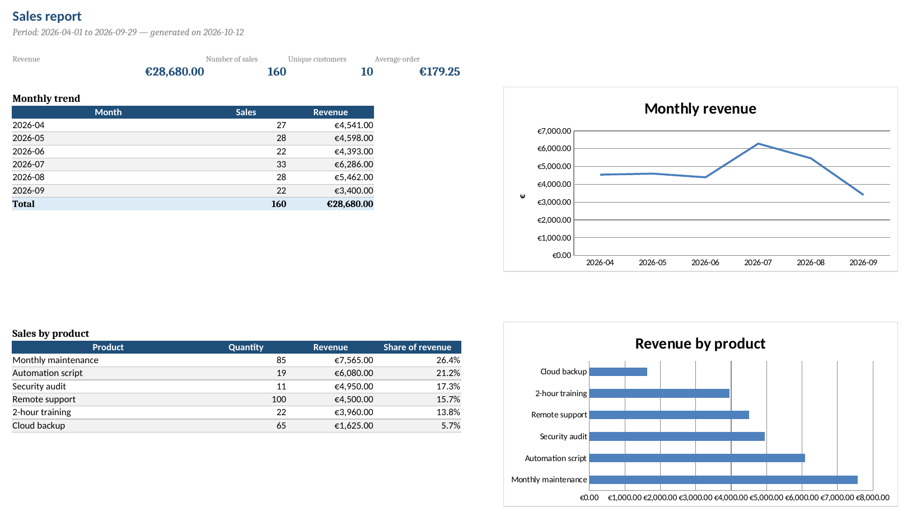

# sales-report-mailer

**Turn a CSV sales export into a presentation-ready Excel report, and email it automatically.**

Many small businesses spend half a day every month copying exports into Excel, adding totals and charts, then emailing the result. This script does all three in a single command, and can run on its own every week or every month.



## What it does

1. **Reads a CSV export** (`,` or `;` separator, decimal commas accepted) and cleanly skips invalid rows.
2. **Computes the key figures**: revenue, number of sales, unique customers, average order, monthly trend, breakdown by product, top customers.
3. **Builds a formatted Excel workbook**:
   - a *Summary* sheet with key figures, tables and two charts;
   - a *Sales detail* sheet with filters and a frozen header row;
   - a print-ready layout (A4, fitted to page width).
4. **Emails the report** (optional), with a summary in the message body and the Excel file attached.

## Installation

```bash
git clone https://github.com/Ryarkhewas/sales-report-mailer.git
cd sales-report-mailer
python -m venv .venv
source .venv/bin/activate      # Windows: .venv\Scripts\activate
pip install -r requirements.txt
```

## Usage

```bash
# Build the report from the sample data
python sales_report.py data/sample_sales.csv

# Choose the output file and the title
python sales_report.py data/sample_sales.csv -o reports/september.xlsx -t "September sales"

# Build the email without sending it (to check it first)
python sales_report.py data/sample_sales.csv --send --dry-run

# Build and send
python sales_report.py data/sample_sales.csv --send
```

## Expected CSV format

| date       | customer   | product        | quantity | unit_price |
|------------|------------|----------------|----------|------------|
| 2026-04-01 | Arts Cafe  | Remote support | 3        | 45.00      |

Extra columns are ignored. Dates can be ISO (`2026-04-01`) or day-first (`01/04/2026`, as in European exports). ISO dates are never reinterpreted, so day and month cannot be swapped.

## Email settings

Copy `.env.example` to `.env` and fill in your SMTP settings:

```bash
cp .env.example .env
```

With Gmail, use an **app password** (Google Account → Security → 2-Step Verification → App passwords), never your main password. The `.env` file is excluded from Git.

## Scheduling

**Linux / macOS (cron)**, on the 1st of every month at 8 am:

```cron
0 8 1 * * cd /path/to/sales-report-mailer && .venv/bin/python sales_report.py /path/to/export.csv --send
```

**Windows**: Task Scheduler → Create Basic Task → "Start a program" with `python.exe` and the arguments `sales_report.py C:\path\to\export.csv --send`.

## Tests

```bash
python -m pytest -q
```

The tests cover loading (formats, date parsing, invalid rows, missing columns), calculations, Excel generation, email building and the command line.

## Security

- SMTP credentials are read from the environment, never written in the code.
- Encrypted SMTP connection (STARTTLS on port 587, SSL on port 465).
- The sample data is fictitious.

## Adapting it

The script is deliberately easy to modify: other columns, other metrics, PDF export, sending to Teams or Slack, reading directly from a database or an API. [Get in touch](https://github.com/Ryarkhewas) for a custom version.

## License

MIT
